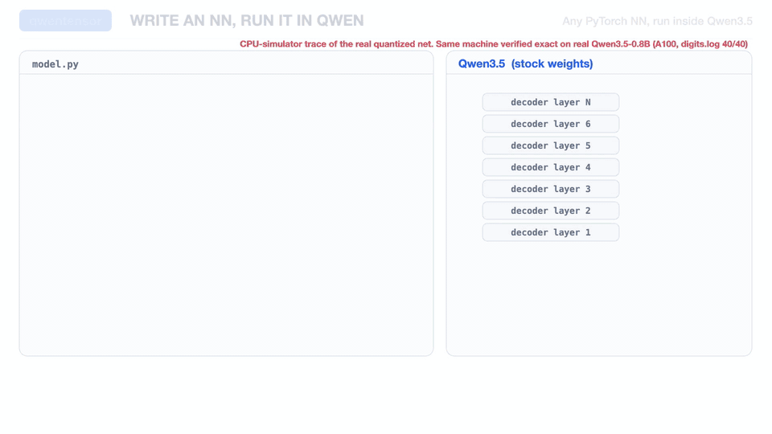
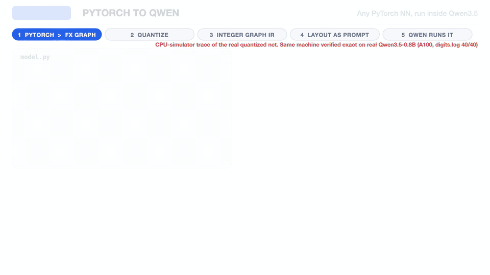
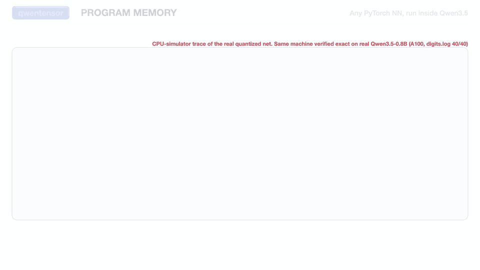
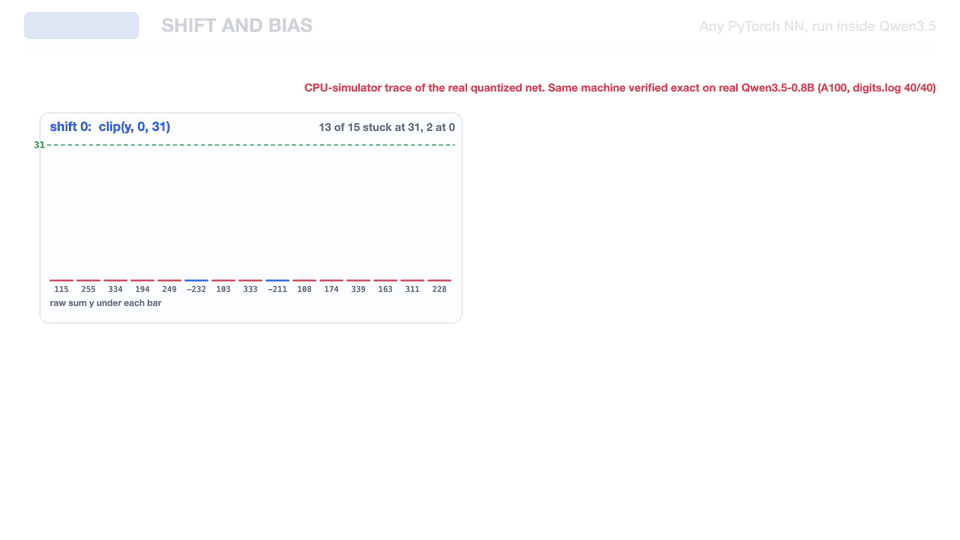
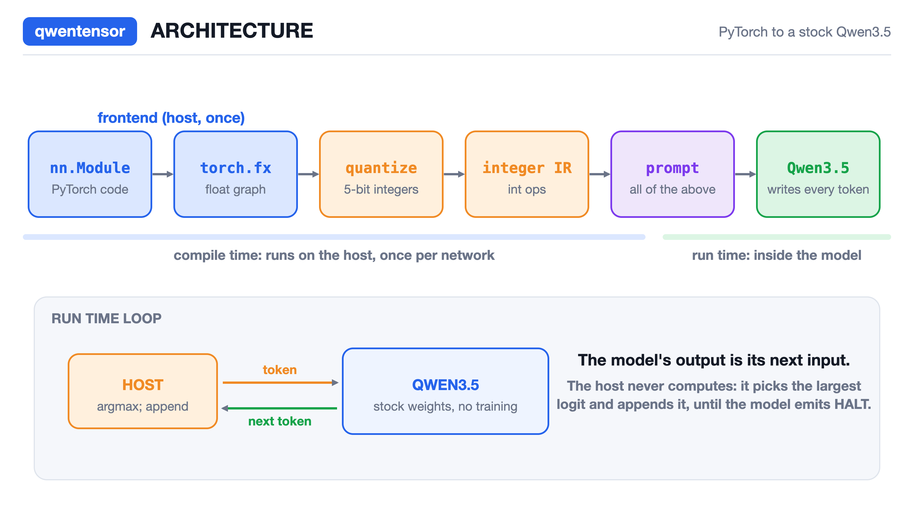
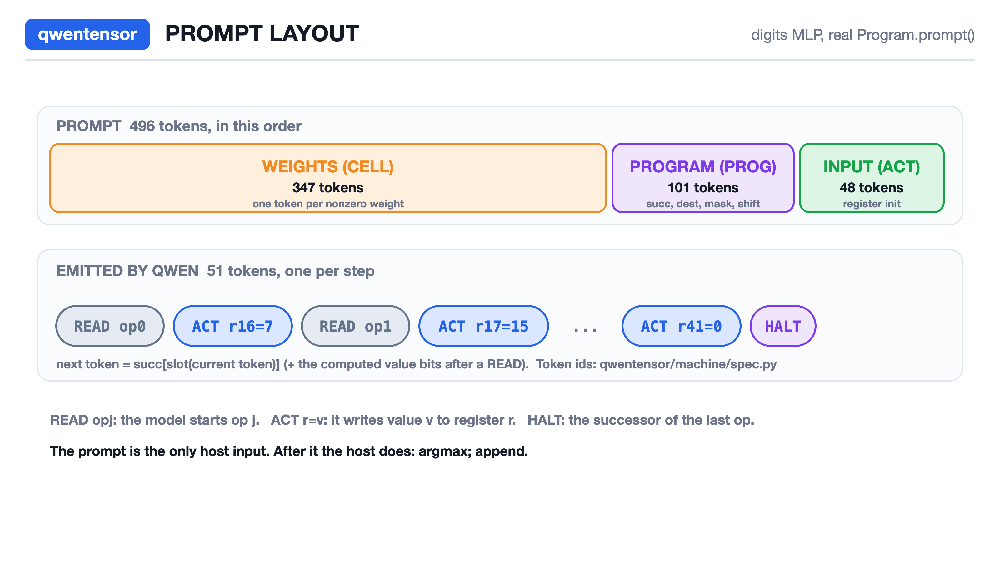
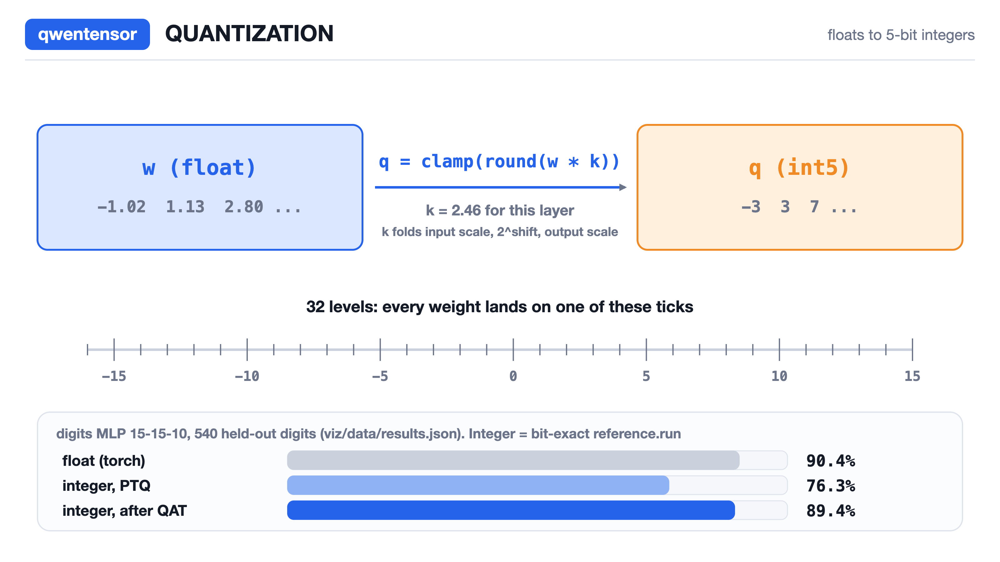

<h1 align="center">🧠 qwentensor</h1>

<p align="center"><b>Write a PyTorch network. Quantize it. Run it <i>inside</i> Qwen3.5.</b><br>
No GPU kernels. No training. The "program" is just the prompt. 🧬</p>

<p align="center">
<a href="https://github.com/Bobliuuu/qwentensor/actions"></a>


</p>

<p align="center"><a href="#-quickstart">🚀 Quickstart</a> · <a href="#-supported-pytorch-ops">🧩 Ops</a> · <a href="#-results-540-held-out-sklearn-digits-seeds-fixed-python-examplesname">📊 Results</a> · <a href="#-limits">⚠️ Limits</a> · <a href="docs/DESIGN.md">📐 Design</a> · <a href="https://github.com/Bobliuuu/qwentpu">🔗 qwenTPU</a></p>

Write a small neural network in PyTorch, quantize it to 5-bit integers, and run it as a program inside Qwen3.5 using the [qwenTPU](https://github.com/Bobliuuu/qwentpu) machinery.
The program, including the schedule, is written in the prompt; the host only runs `argmax; append`.

```python
import qwentensor as qt
net = qt.compile(model, calib_data, input_shape=(64,), backend="qwen")   # nn.Module in
print(net.predict(x))                                                    # tokens out, bit-exact vs numpy golden
```

✨ **At a glance**
* 🐍 any small `nn.Module` (Linear / ReLU / Conv / residual Add / pooling)
* 🔢 5-bit integer weights, per-layer shift requantize
* 📝 the schedule, successors and masks are **tokens in the prompt**: swap the prompt, swap the program
* ✅ bit-exact vs a numpy golden on a real Qwen3.5-0.8B (A100): **40/40** digits MLP, **24/24** across four different programs
* 🤖 the host does only `argmax; append`

<p align="center"><a href="docs/qwentensor_demo.mp4"></a><br>
🎬 <a href="docs/qwentensor_demo.mp4"><b>Watch the 1:42 demo video</b></a> (hero, program memory, shift requantize)</p>

**📍 Status.** The frontend, quantizer and bit-exact numpy golden are done. The executor reproduces the golden bit-for-bit on a **CPU simulator of the circuit**
(qwenTPU's float64 circuit-IR evaluator). On the real model, **four programs have been run**. First, the quantized digits MLP 15-15-10 (u5s5, shifts 2 and 4) on
Qwen3.5-0.8B (A100, bf16): 20 held-out digits x 2 readouts (code bits and lm_head) = 40/40 exact, emitted tokens equal to the numpy token golden and outputs equal
to `reference.run` (prompt 434 tokens, 50 emitted, 9 chip layers, hidden 3072, vocab 17616; 95% argmax accuracy on those 20 digits). The host did only `argmax; append`.
Log: [results/a100_digits.log](results/a100_digits.log).
Second, **one compiled 14-layer model** (Spec rows=16, cols=(15,12,8), fan 2, smax 7, 40 ops, hidden 3712, vocab 26616, same A100 / bf16) ran four different programs,
6 inputs each, 24/24 exact (emitted tokens equal to the numpy token golden and outputs equal to `reference.run`); only the prompt differed:

| program | exact | prompt tokens | emitted |
|---|---|---|---|
| digits MLP 15-15-10 | 6/6 | 459 | 50 |
| random MLP 20-8-4 (K=20 spans 2 tiles) | 6/6 | 282 | 24 |
| random 4-layer MLP 8-5-5-5-4 | 6/6 | 259 | 38 |
| residual block (concat, identity rows) | 6/6 | 222 | 28 |

Log: [results/a100_general.log](results/a100_general.log). The deep MLP and the CNN below, and the frontend's residual MLP 64-32-[32+res]-10, have not run on the real model.
See [docs/EXECUTOR.md](docs/EXECUTOR.md) section 7.

## 🔀 How it differs from qwenTPU

| | what runs | who decides the computation |
|---|---|---|
| qwenTPU v1 | one fixed matvec | the host drives the array one operation at a time |
| qwenTPU v2 | a hardcoded chain of matvec + requantize stages | the chain is compiled in; the program only varies widths and depth |
| **qwentensor** | any quantized network of the supported ops, written as a PyTorch `nn.Module` | the prompt: each op's successor, destination register, column mask and shift are program-memory tokens |

```
nn.Module --torch.fx--> float IR --quantize (PTQ, optional STE QAT)--> integer IR --+--> reference.run   (numpy golden, bit-exact)
                                                                                    +--> machine/        (general executor: prompt-written program, tiling, partial sums)
```

<p align="center"></p>

**Program memory.** The prompt writes a successor table into DeltaNet state, and the next token is looked up from it, so the program is prompt data:

<p align="center"></p>

**Why a shift requantize and bias rows matter.** Without them the integer network collapses; with them it recovers:

<p align="center"></p>


| piece | path | status |
|---|---|---|
| IR contract (ops, ranges, lowering table, supported/unsupported ops) | `docs/IR.md`, `qwentensor/ir.py` | done |
| torch.fx frontend | `qwentensor/frontend.py` | done |
| post-training quantizer + STE fine-tuning | `qwentensor/quant.py` | done |
| bit-exact numpy interpreter (the golden) | `qwentensor/reference.py` | done |
| executor: program memory, tiling, shift requant, bias rows | `qwentensor/machine/`, `docs/EXECUTOR.md` | bit-exact on the CPU simulator and on the real Qwen3.5-0.8B (A100) for the digits MLP and three small programs (K-tiled MLP, 4-layer MLP, residual block) |
| user API `qt.compile(...)` | `qwentensor/api.py` | done (`backend="sim"`); `backend="qwen"` needs a GPU (four programs were run on the real model via `scripts/gpu_run.py`) |
| examples, tests | `examples/`, `tests/` | done (46 CPU tests, 45 pass) |

Design write-up: [docs/DESIGN.md](docs/DESIGN.md). Project page: `docs/site/`.

## 🚀 Quickstart

```bash
pip install -e ".[dev]"                 # torch, numpy, pytest, scikit-learn
pip install -e ~/qwentpu_src/qwentpu    # needed by qwentensor.machine (the executor / simulator)
OMP_NUM_THREADS=1 python -m pytest -q tests   # 46 tests, about 1 min
python examples/digits_mlp.py           # float vs int accuracy (also deep_mlp.py, cnn.py, residual_mlp.py)
python examples/run_digits_mlp.py 20    # qt.compile + run 20 digits on the circuit simulator, assert machine == reference
                                        # (also run_deep_mlp.py, run_residual.py, run_cnn.py: smaller variants that fit the machine)
```

```python
import qwentensor as qt

# model: a trained float nn.Module; Xtr, ytr: training samples and labels (N, *input_shape)
prog = qt.compile(model, Xtr, input_shape=(15,), labels=ytr,
                  qat=dict(epochs=60, lr=0.01), backend="sim")   # "qwen" = real Qwen3.5 (CUDA + QWEN_DIR); see scripts/gpu_run.py
print(prog.explain())                  # neurons, ops, registers, columns, weight cells, prompt length
y = prog.run(Xte)                      # integer output vectors decoded from the emitted tokens;
                                       # asserts equality with reference.run (qt.MachineMismatch otherwise)
pred = y.argmax(1)
prog.accuracy(Xte, yte, on="float")    # also on="int" (golden) and on="machine"
prog.save("net.json")                  # qt.load("net.json")
```

`qt.compile(model, calib_data, input_shape, profile="v2.1", backend="sim"|"qwen", labels=None, qat=dict(...), ab=5, wb=5, bias_rows=1, rows=16, verify=True)` returns a `Program` with
`run`, `predict`, `check`, `reference`, `accuracy(on="machine"|"int"|"float")`, `cost`, `explain`, `save`; `qt.load` reads it back.
Errors: `qt.UnsupportedOpError` names the op; `qt.DoesNotFit` gives the neuron count, a per-layer breakdown, the limits and what to change; `qt.MachineMismatch` means the machine output differs from `reference.run` (an executor bug).
`DoesNotFit` also checks the 126-column limit: every register tile a neuron reads costs one column, so a 64-input layer needs about 5 columns per neuron.
Step-by-step (what `compile` does): `frontend.from_torch` -> `quant.quantize(fg, X_calib, QConfig("v2.1", bias_rows=4))` -> optional `quant.qat` ->
`machine.sched.compile_graph` -> `Program.prompt()`.

## 🏗️ Architecture at a glance

<p align="center"></p>

<p align="center"></p>

Prompt and emitted-token counts vary with the network and the Spec; the diagram shows one digits-MLP build.

<p align="center"></p>

## 🧩 Supported PyTorch ops

Authoritative table: [docs/IR.md](docs/IR.md) section 3.

| supported | rejected with `UnsupportedOpError` (and how it could be added, see DESIGN.md section 10) |
|---|---|
| `Linear`, `ReLU`, `Conv2d` (im2col, groups=1, dilation=1, zero padding, any stride), residual `Add`, `AvgPool2d` / `AdaptiveAvgPool2d`, `Flatten` / `view` / `reshape`, `Embedding` on the integer input, `Identity` / `Dropout` (eval), trailing `argmax` | `Softmax` / `log_softmax` (a trailing one before argmax is dropped), `LayerNorm`, `BatchNorm` (fold it first; not automatic yet), `GELU` / `SiLU` / `Sigmoid` / `Tanh`, `MaxPool2d`, attention, data x data products, recurrent layers, control flow |

## ⚠️ Limits

* **Size.** About 100 neurons is the practical ceiling on the 0.8B model (heads grow about 2 per column); at most 128 ops and 126 physical columns. Every conv output position is a separate neuron set (`groups` duplicates the weights), so the 8x8 CNN below is far over that: it is an IR/quantizer example, not a machine one.
* **No loops, no data-dependent branches, no early exit.** Registers are single-assignment.
* **Wide first layers are not solved.** A neuron may read at most `fan * (rows - 1)` inputs (K tiling adds exact counts inside one adder tree, no digit tokens); a 784-wide input layer does not fit.
* **No weight streaming**: all weights are resident. **Unsigned interior activations**; final logits are relu-clamped to 0..31.
* **Small programs only on the real Qwen3.5.** The largest machine run there is 14 chip layers, 40 ops, vocab 26616; the deep MLP and CNN do not fit.

## 📊 Results (540 held-out sklearn digits, seeds fixed, `python examples/<name>.py`)

Integer accuracy = bit-exact `reference.run` of the quantized IR (what the machine must reproduce). "PTQ" = post-training quantization with 512 calibration
samples taken from the training split; "+QAT" = STE fine-tuning of the integer weights, model selection on TRAIN accuracy only.

| network | float (torch) | v2.0 (no shift), bias 1 row: PTQ / +QAT | v2.1 (shift), bias 1 row: PTQ / +QAT | v2.1, bias 4 rows: PTQ / +QAT | tile matvecs on 16x16 |
|---|---|---|---|---|---|
| digits MLP 15-15-10 (qwenTPU's) | 90.4% | 43.7% / 82.6% (input 0..12); **87.6%** with qwenTPU-style QAT from scratch (250 ep x 4 seeds) | 76.3% / 89.4% | 85.2% / 89.8% | 4 |
| deep MLP 64-96-64-32-10 | 97.8% | 24.1% / 78.9% | 97.6% / 97.6% | 97.8% / 97.8% | 83 |
| CNN conv4-conv8-avgpool-fc (8x8) | 97.4% | 14.3% / 14.3% (QAT fails) | 87.6% / 97.2% | 96.5% / 97.0% | 299 |
| residual MLP 64-32-[32+res]-10 | 97.4% | 49.4% / 83.7% | 96.1% / 96.1% | 96.9% / 96.9% | 33 |

Executor status per row: only the digits MLP has been compiled and run through the machine with its real quantized weights (tests, shifts 2 and 4: output equal to
`reference.run` in the circuit simulator, and exact on the real Qwen3.5-0.8B on an A100, in both the 9-layer and the 14-layer machine). The other three are quantizer results; the deep MLP (202 neurons) and the CNN (every conv position is a neuron set) exceed the
~100 neuron ceiling, and the frontend's residual MLP 64-32-[32+res]-10 has not been run through the executor. A residual *block* (concat plus identity rows) did run on the real model, but that is a different, smaller program. The other three rows have not run on the real model.

Honest reading of the losses:

* **v2.0 hardware (shift = 0) is the dominant loss.** With no shift the layer's output scale is tied to the integer weight range, so PTQ collapses
  (24-49% on everything but the tiny net, 14% on the CNN). qwenTPU's own 87.6% on the digits net is reproduced (87.59%) only by integer-aware training
  from scratch, and that does not scale: 4-layer and conv nets stay at 79-84% (MLPs) or fail (CNN). A per-layer output shift (v2.1 gadget) fixes it:
  97.6% on the deep MLP, 97.2% on the CNN. Making v2.1 real in the datapath is the single biggest accuracy lever.
* **Bias range.** The bias is one weight on a constant-1 row, so it is limited to [-16, 15] *in accumulator units*; with shift s that is only 2^-s of the activation range. This
  clipped 40-60% of the biases of the small digits net (76% PTQ vs 85% with 4 constant rows). Costs rows per tile (`Graph.bias_rows`).
* Final logits are relu+clamp (0..31): negative logits become 0 and ties are possible (`logits="linear"` quantizes signed logits for comparison but is not machine-native).
* 5-bit weights/activations, input quantization (0..31, or 0..12 for qwenTPU parity), per-tensor scales, no per-channel scales: PTQ gap to float is 0-1 point on the deep nets
  and 5-14 points on the tiny 15-15-10 net before QAT. Float numbers vary +-1.5 points with the training seed; ours are one fixed seed each.
* No BatchNorm folding yet, no signed interior activations, classification-only QAT.

## ⚙️ Compile and run through the machine (`examples/run_*.py`, CPU circuit simulator)

Held-out sklearn digits (540). Machine accuracy is only measured for the digits MLP.

| network | neurons | fits the machine | machine == `reference.run` | float / int / machine accuracy |
|---|---|---|---|---|
| digits MLP 15-15-10 (496-token prompt) | 25 | yes | **540/540 digits** (about 4.1 s/digit under load) | 0.9037 / 0.8944 / 0.8944 |
| deep MLP 64-96-64-32-10 (the full network above) | 202 | no, `DoesNotFit` | - | - |
| residual MLP 64-32-[32+res]-10 | 106 (408 columns) | no, `DoesNotFit` | - | - |
| CNN conv4-conv8-avgpool-fc | 778 | no, `DoesNotFit` | - | - |
| deep variant 15-24-16-10 | 50 | yes | first 3 digits only | 0.9056 / 0.9037 / not measured |
| residual variant, width 10 on the 15 pooled features | 40 | yes | first 3 digits only | 0.8685 / 0.8426 / not measured |
| CNN variant 4x4 input, conv3x3 1->2 ch + fc | 42 | yes | first 3 digits only | 0.9185 / 0.8722 / not measured |

The variants' float / int accuracy is from `reference.run` on all 540 digits; their machine accuracy was not measured. All of the above is the CPU simulator. Real-model claims are only the two A100 logs in Status.

## 🔭 Where the model run is still open

* `scripts/gpu_run.py digits` and `general` are done (see Status). Still open on the real model: the frontend's residual MLP, anything beyond about 40 ops / 100 neurons, other Qwen3.5 sizes (only 0.8B was run), and a throughput measurement.
* Not covered by the IR and how it could be: [docs/DESIGN.md](docs/DESIGN.md) section 10.

## 🙏 Credits and license

Built on [qwenTPU](https://github.com/Bobliuuu/qwentpu) (the in-weights integer array, the requantize gadget, the circuit-IR evaluator). Design vocabulary (DeltaNet rows as RAM, tokens as the trace) comes from
[Qwenputer](https://github.com/divagr18/qwenputer) and [QwenPU](https://github.com/divagr18/QwenPU); no code is shared with them. Base models: Qwen3.5. MIT licensed (`LICENSE`).

```bibtex
@misc{qwentensor2026,
  title  = {qwentensor: PyTorch networks as prompt-written programs inside Qwen3.5},
  author = {Bobliuuu},
  year   = {2026},
  note   = {https://github.com/Bobliuuu/qwentensor}
}
```
